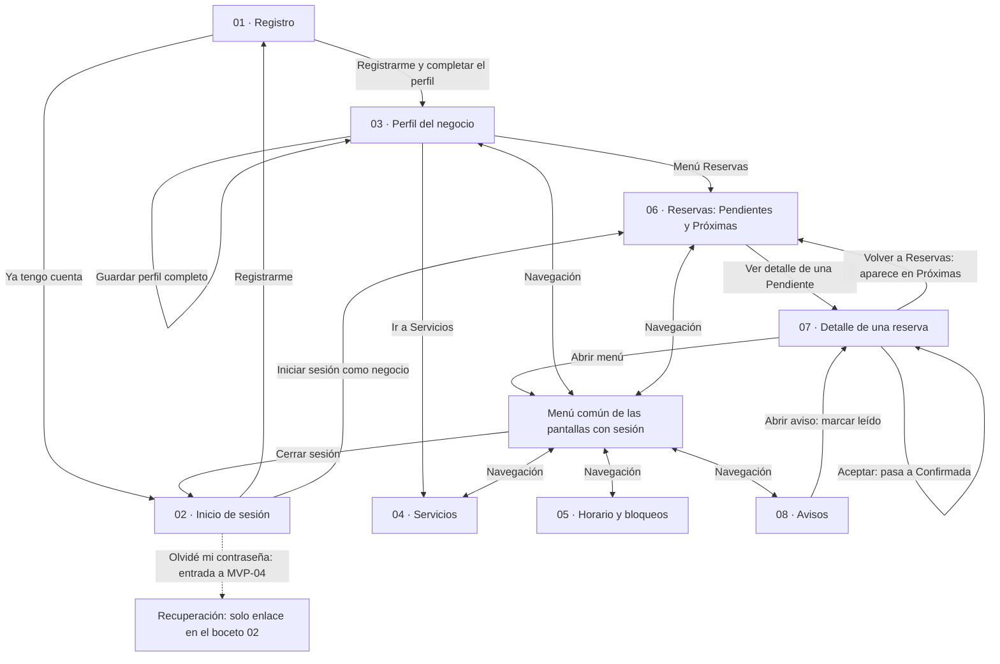
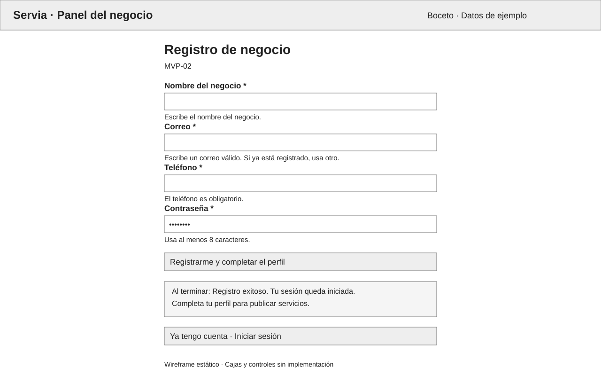
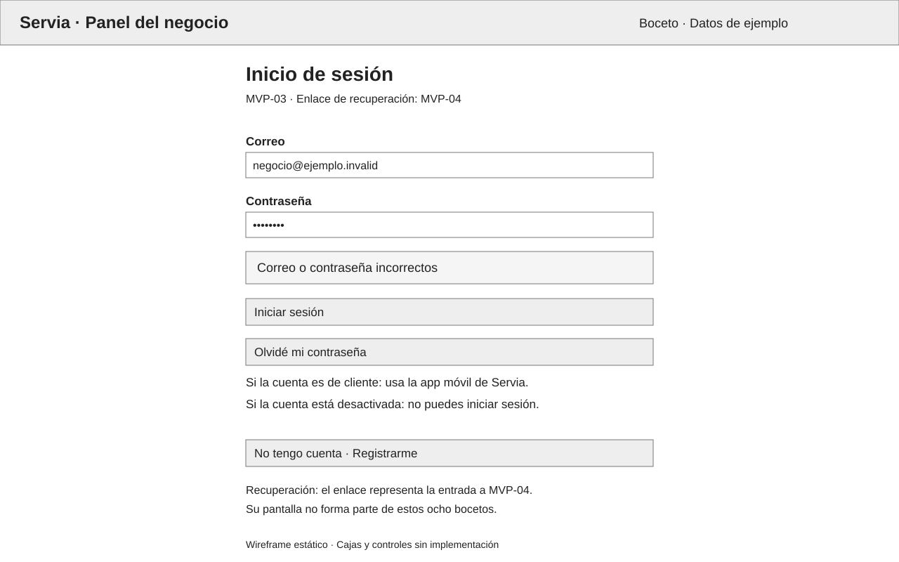
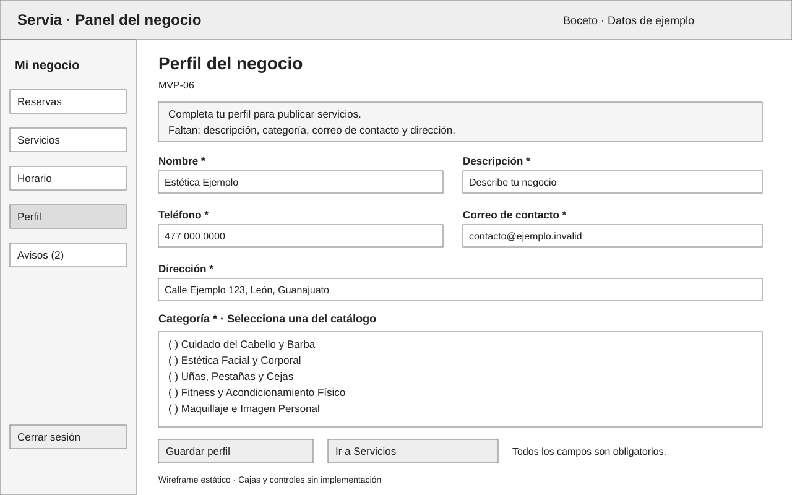
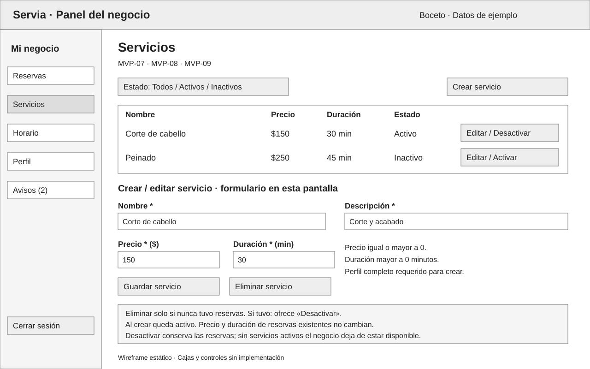
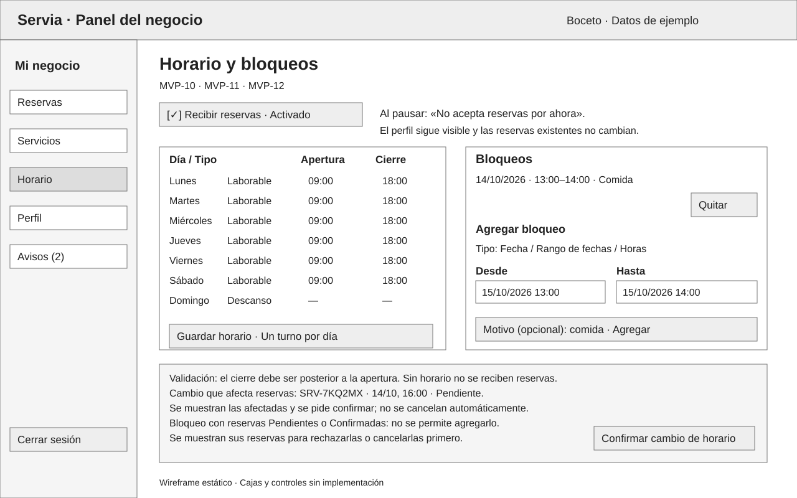
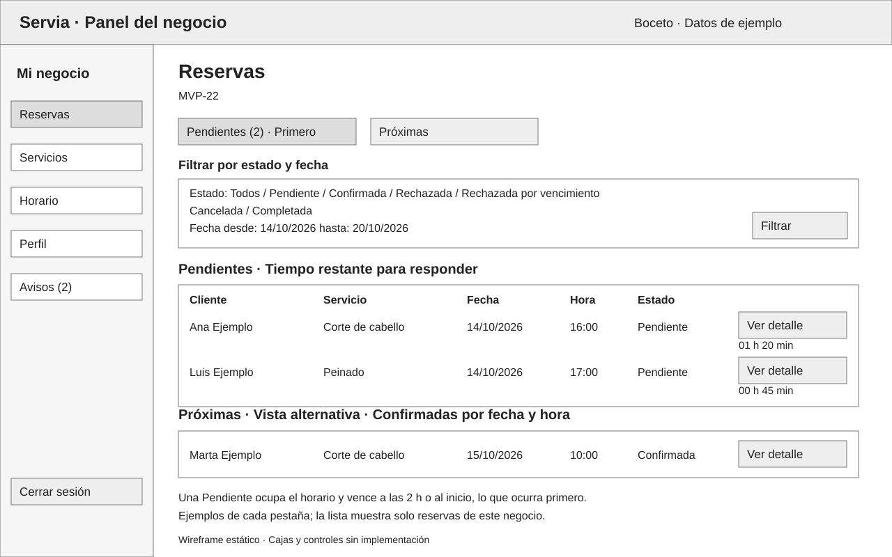
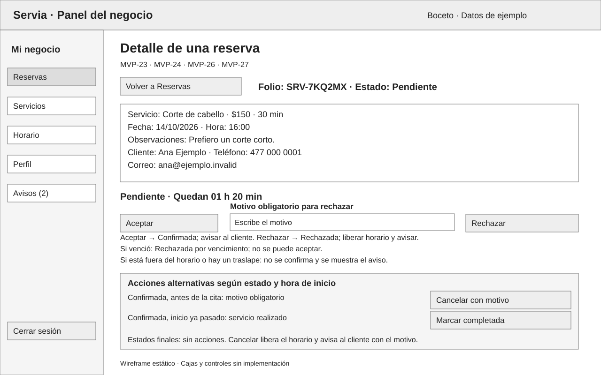
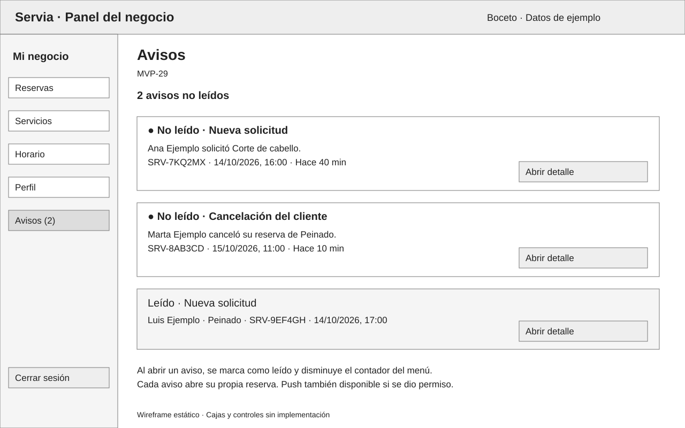

# Wireframes del panel del negocio

Estos bocetos de baja fidelidad permiten revisar las pantallas y recorrer el flujo del negocio antes de implementar el panel de Servia. Cubren el alcance aprobado de Servia_UI#5 y las historias indicadas en cada pantalla. La revisión del Product Owner queda pendiente en el PR #13.

**Herramienta usada:** SVG escritos a mano en este repositorio, en `docs/wireframes/`. Cada pantalla mide 1280 × 800, usa cajas, textos y botones en grises y tiene fondo blanco explícito para mantener la legibilidad en GitHub claro y oscuro.

Los datos son ejemplos ficticios. Los errores y las acciones alternativas representan distintos estados de una misma pantalla. Los bocetos son estáticos: los botones describen acciones y los enlaces entre SVG facilitan la navegación cuando el visor los admite; no ejecutan operaciones ni guardan información.

## Navegación y recorrido

Las seis pantallas con sesión comparten el menú **Reservas, Servicios, Horario, Perfil, Avisos (con contador) y Cerrar sesión**. El menú permite moverse entre esas cinco secciones desde cualquiera de ellas y desde el detalle de una reserva. Cerrar sesión vuelve al inicio de sesión.

**Cómo probarlo: registrarse → completar el perfil → aceptar una reserva.**

1. Abrir Registro (01), revisar los cuatro campos y sus errores, y seguir **Registrarme y completar el perfil**. El registro inicia sesión y pide completar el perfil para publicar servicios.
2. En Perfil (03), completar nombre, descripción, categoría, teléfono, correo de contacto y dirección; revisar el aviso de faltantes y **Guardar perfil**. La categoría se elige de las cinco opciones aprobadas del catálogo (D7).
3. Para preparar el negocio, pasar a Servicios (04), crear un servicio activo y configurar el Horario (05) con **Recibir reservas** activado. En este recorrido de lectura se supone que un cliente ya envió la solicitud desde su app; crear esa solicitud no forma parte del panel.
4. Usar **Reservas** en el menú, abrir **Pendientes** (06) y revisar el tiempo restante. Seleccionar **Ver detalle** de la solicitud con folio `SRV-7KQ2MX`.
5. En Detalle (07), revisar los datos del cliente y pulsar **Aceptar**: representa el paso de Pendiente a Confirmada y el aviso al cliente. Volver a Reservas y comprobar la vista **Próximas**. La solicitud debe seguir vigente y dentro del horario disponible; si venció o el horario ya no permite atenderla, no se confirma.

## Pantallas e historias cubiertas

### 01 · Registro

**Historia:** MVP-02. Nombre del negocio, correo, teléfono y contraseña; errores por campo y correo ya registrado; entrada al inicio de sesión y continuación al perfil con aviso de registro exitoso.

[Abrir Registro](wireframes/01-registro.svg)

### 02 · Inicio de sesión

**Historias:** MVP-03 y entrada de recuperación de MVP-04. Correo, contraseña, error de acceso, aviso para cuentas de cliente, cuenta desactivada, enlace a Registro y **Olvidé mi contraseña**. MVP-04 se representa únicamente por ese enlace, sin añadir otra pantalla al alcance aprobado.

[Abrir Inicio de sesión](wireframes/02-inicio-de-sesion.svg)

### 03 · Perfil del negocio

**Historia:** MVP-06. Los seis campos obligatorios, catálogo aprobado de cinco categorías, aviso de campos faltantes y **Guardar perfil**. Un perfil incompleto impide publicar servicios.

[Abrir Perfil del negocio](wireframes/03-perfil-del-negocio.svg)

### 04 · Servicios

**Historias:** MVP-07, MVP-08 y MVP-09. Lista con nombre, precio, duración y estado; filtro activos/inactivos; formulario de creación/edición con descripción; activar, desactivar y eliminar. Solo se elimina si nunca tuvo reservas; si tuvo, se ofrece desactivar. Las reservas existentes conservan su precio y duración.

[Abrir Servicios](wireframes/04-servicios.svg)

### 05 · Horario y bloqueos

**Historias:** MVP-10, MVP-11 y MVP-12. Semana con días laborables o de descanso y un turno de apertura/cierre; agregar o quitar bloqueos por fecha, rango o intervalo de horas, con motivo opcional; interruptor **Recibir reservas**. Se muestran las reservas afectadas por un cambio de horario y se pide confirmación; un bloqueo sobre Pendientes o Confirmadas no se permite.

[Abrir Horario y bloqueos](wireframes/05-horario-y-bloqueos.svg)

### 06 · Reservas

**Historia:** MVP-22. Pendientes primero con tiempo restante para responder, Próximas con Confirmadas por fecha y hora, filtros de estado y fecha, y filas con cliente, servicio, fecha, hora y estado. Ambas vistas se muestran como ejemplos alternativos dentro del mismo boceto.

[Abrir Reservas](wireframes/06-reservas.svg)

### 07 · Detalle de una reserva

**Historias:** MVP-23, MVP-24, MVP-26 y MVP-27. Folio, estado, servicio, fecha, hora, observaciones y nombre, teléfono y correo del cliente. Para una Pendiente vigente: **Aceptar** o **Rechazar** con motivo obligatorio. Para una Confirmada antes de la cita: **Cancelar** con motivo obligatorio. Para una Confirmada cuyo inicio ya pasó y cuyo servicio se realizó: **Marcar completada**. Los estados finales no tienen acciones; una vencida no puede aceptarse.

[Abrir Detalle de una reserva](wireframes/07-detalle-de-reserva.svg)

### 08 · Avisos

**Historia:** MVP-29. Lista de solicitudes nuevas y cancelaciones del cliente, indicador de no leídos y acceso al detalle de la reserva correspondiente. Abrir un aviso lo marca como leído y reduce el contador; el detalle refleja el estado de esa reserva. También se indica la recepción push si se dio permiso.

[Abrir Avisos](wireframes/08-avisos.svg)

